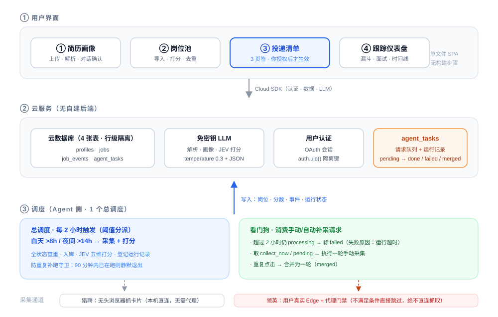
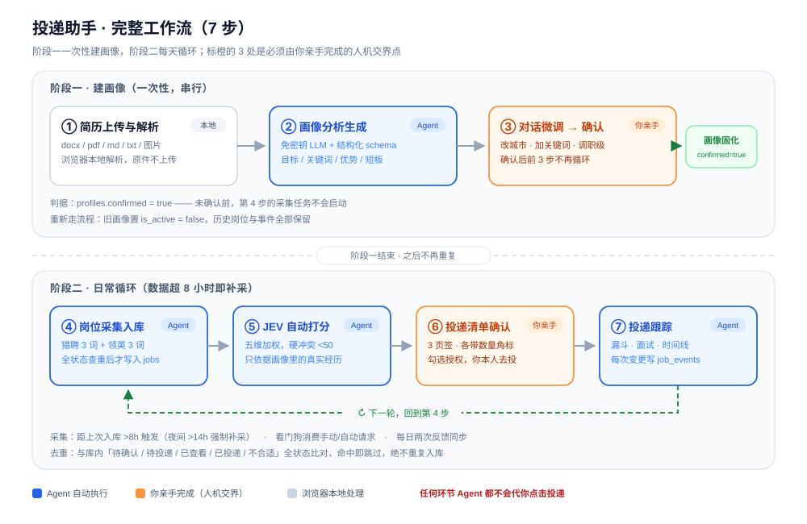
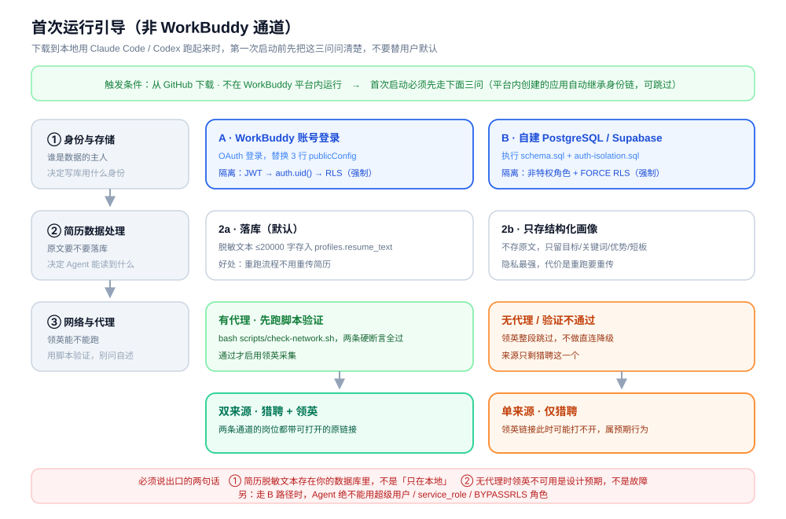

# Offer Radar · 投递助手

[](https://github.com/Jojo-dai/Offer_Radar/actions/workflows/ci.yml)
[](LICENSE)

> `offer-radar` = **offer 雷达**：像雷达一样扫描岗位、锁定目标，但扣动扳机（投递）的永远是你自己。

一个**不替人投递**的求职岗位 Agent：自动采集岗位 → 结构化打分 → 生成投递清单等你确认 → 你在平台亲手投递 → 回到仪表盘跟踪进展。

它不是"一键海投机器人"。它的定位是**把你的求职情报工作自动化，把投递这个动作留给你自己**。

> 单文件应用（`app/index.html`）+ 云数据库 + 1 个总调度任务，没有构建步骤，没有后端代码。

## ⚠️ 出身声明：本项目 Agent 在 WorkBuddy 原生态下孵化

本项目的 Agent 能力（定时采集、浏览器控制、免密钥 LLM、云数据库、用户认证）**原生构建在 WorkBuddy 平台上**，生产环境的采集 prompt 直接调用 WorkBuddy 专属工具（`mcp__browser__*`）。

**如果你使用其他 Agent（Claude Code / Codex / 自建脚本）来运行或复刻本项目**，WorkBuddy 专属部分不会自动可用，必须先阅读以下说明文档（按阅读顺序标注编码）：

| 阅读顺序 | 文档编码 | 内容 | 解决什么 |
|---|---|---|---|
| ① | `docs/09-portability-auth.md` + `scripts/auth-isolation.sql` | 身份与数据隔离 | 离开 WorkBuddy 后，简历数据怎么继续做到强制隔离 |
| ② | `docs/10-collect-adapters.md` | 采集通道适配 | 没有工作台浏览器工具时，猎聘/领英两条采集通道如何三层互备不断线 |
| ③ | `AGENTS.md` §3.7 / §3.8 | 复刻契约（首次三问 + 通道互备） | AI 复刻时的必做验收项 |
| ④ | `docs/06-network.md` | 网络边界 | 领英采集的门禁判据（接口实测，不看 IP）与失败归因 |

并完成 [首次运行引导](#首次运行引导非-workbuddy-通道必读) 的三问确认后，才能开始采集。

> 在 WorkBuddy 平台内创建/复用本项目则**无需以上步骤**，身份链（OAuth → `auth.uid()` → RLS）自动继承。

---

## 目录

- [⚠️ 出身声明：WorkBuddy 原生态孵化](#⚠️-出身声明本项目-agent-在-workbuddy-原生态下孵化)
- [下载与安装（三种方式，10 秒开始）](#下载与安装三种方式10-秒开始)
- [它能做什么 / 不做什么](#它能做什么--不做什么)
- [整体架构](#整体架构)
- [完整工作流（7 步）](#完整工作流7-步)
- [工作边界](#工作边界)
- [工作产出](#工作产出)
- [网络边界：领英能不能跑，看这一节](#网络边界领英能不能跑看这一节)
- [稳定性防线：出过的问题不会再犯](#稳定性防线出过的问题不会再犯)
- [跨 Agent 复现：身份与数据隔离](#跨-agent-复现身身份与数据隔离)
- [首次运行引导（非 WorkBuddy 通道必读）](#首次运行引导非-workbuddy-通道必读)
- [快速开始](#快速开始)
- [采集通道适配：换一个 Agent 环境怎么跑](#采集通道适配换一个-agent-环境怎么跑)
- [给 AI 的重建入口](#给-ai-的重建入口)
- [目录结构](#目录结构)
- [常见问题](#常见问题)
- [许可与合规](#许可与合规)

---

## 下载与安装（三种方式，10 秒开始）

```bash
# 方式 1 · git clone（推荐，可随时 git pull 更新）
git clone https://github.com/Jojo-dai/Offer_Radar.git
cd offer-radar
```

**方式 2 · 网页直下**：仓库页右上角绿色 `<> Code` 按钮 → `Download ZIP` → 解压即用（无需 git）。

**方式 3 · 喂给 AI**：clone 或解压后，把 `README.md` + `AGENTS.md` 的路径告诉 Claude Code / Codex，说一句「按 AGENTS.md 复刻这个项目」，AI 会照规格重建。

> ⚠️ 下载后**不需要也不应该**安装任何依赖就能读完整个项目；要跑起来才按[快速开始](#快速开始)的路线走。仓库里没有任何密钥（全是占位符），你自己的密钥自己填。

---

## 它能做什么 / 不做什么

| ✅ 会做 | ❌ 绝不做的 |
|---|---|
| 解析你的简历（Word / PDF / Markdown / 图片 OCR），生成结构化求职画像 | 代替你点击"投递"按钮、填表、发消息给 HR |
| 按画像在猎聘 / 领英搜索岗位并入库（每天 2 次定时 + 手动触发） | 使用你的账号密码登录第三方平台 |
| 按 JEV 五维方法论给每个岗位打匹配度（0-100）并写理由 | 绕过验证码、人机验证、风控墙 |
| 按匹配度倒排生成投递清单，等你勾选授权 | 抓取候选人 / HR 的个人隐私信息 |
| 记录你的投递、面试、拒绝进展，生成漏斗与看板 | 把数据分享给除你以外的任何人（行级隔离） |
| 全状态查重，已投递 / 已拒绝的岗位不会重新冒出来 | 承诺投递结果、代写简历中的虚构经历 |

---

## 整体架构

<p align="center">
  
</p>

<details>
<summary>文字版架构图（无图片环境 / 纯文本阅读）</summary>

```
                    ┌─────────────────────────────────────────┐
   你的浏览器 ──────▶│  app/index.html（单文件 SPA）            │
                    │  ① 简历画像  ② 岗位池  ③ 投递清单  ④ 看板 │
                    └───────────┬─────────────────────────────┘
                                │ WorkBuddy Cloud SDK
                ┌───────────────┼────────────────┬──────────────┐
                ▼               ▼                ▼              ▼
        ┌──────────────┐ ┌────────────┐  ┌────────────┐ ┌─────────────┐
        │ 云数据库      │ │ 免密钥 LLM  │  │ 用户认证    │ │ agent_tasks │
        │ profiles     │ │ 画像/解析/  │  │ OAuth 会话  │ │ 采集请求队列 │
        │ jobs         │ │ 打分        │  │            │ │ 运行记录     │
        │ job_events   │ │            │  │            │ │             │
        └──────▲───────┘ └────────────┘  └────────────┘ └──────▲──────┘
               │                                                  │
               │            总调度（Agent 侧，1 个）              │
               └──────────────┬───────────────────────────────────┘
                              ▼
              ┌───────────────────────────────────┐
              │ 总调度 / 每 2 小时触发一次        │
              │ 白天 距上次入库 >8h 就采集        │
              │ 夜间 >14h 强制补采（自愈）        │
              │ pending 超 30min 优先消费         │
              └───────────────────────────────────┘
                     │                    │
                     ▼                    ▼
          猎聘（无头浏览器）      领英（直连 jobs-guest 接口）
```

</details>

**两条数据链路**

- **写链路**：总调度 / 手动请求 → 采集 → 全状态查重 → 入库 → 自动打分
- **读链路**：你在应用里看画像 / 岗位池 / 投递清单 / 看板，所有读写都过 RLS，只能看到自己的数据

---

## 完整工作流（7 步）

<p align="center">
  
</p>

前 3 步是**一次性串行**（做完并确认后不再重复）；第 4-7 步**每天循环**。图中橙色节点是必须由你亲手完成的人机交界点，其余由 Agent 自动完成。

### 阶段一：建画像（一次性，串行）

#### 第 1 步 · 简历上传与解析

- **输入**：`docx`（mammoth）/ `pdf`（pdf.js）/ `md` / `txt` / `png|jpg`（OCR）
- **处理**：全部在浏览器本地解析，不上传原始文件；解析后在本机做敏感字段脱敏（手机号、邮箱、身份证、具体住址）
- **产出**：纯文本简历内容（供第 2 步喂给模型）

#### 第 2 步 · 画像分析与生成

- **输入**：第 1 步的纯文本 + 你的补充说明
- **处理**：调用免密钥 LLM，按结构化 schema 生成画像
- **产出**：`profiles` 记录

```jsonc
{
  "target_profile": {          // 目标岗位：职级、方向、行业、城市（含 cities_en）
    "roles": ["数据平台工程师", "后端开发工程师"],
    "level": "高级/资深",
    "industries": ["互联网", "云计算"],
    "cities": ["杭州", "成都"],
    "cities_en": ["Hangzhou, China", "Chengdu, China"]
  },
  "keywords": ["实时计算", "数据湖", "后端开发"],      // 猎聘用：中文
  "keywords_en": ["Backend Engineer", "Data Platform Engineer"], // 领聘用：英文
  "competitiveness": ["8 年后端与数据平台经验", "TB 级数据链路落地 5+ 个"],
  "gaps": ["缺少大规模分布式训练经验"]
}
```

#### 第 3 步 · 多轮对话调整 → 确认画像

- 你可以直接在应用里和模型对话微调（改城市、加关键词、调整职级），每次调整都会重算画像
- **点了「确认画像」之后，第 1-3 步不再循环**，`profiles.confirmed = true`，采集任务才会开跑
- 想改画像随时可以重新走一次（旧的会被置为 `is_active = false`）

### 阶段二：日常循环（每天）

#### 第 4 步 · 岗位采集入库（阈值触发，不等整点）

| 触发 | 条件 | 说明 |
|---|---|---|
| 阈值（白天） | 距上次入库 **> 8 小时** | 采集 + 打分。调度每 2 小时触发一次，触发时数据陈旧就采，**不再死等 8:00 / 18:00 整点** |
| 阈值（夜间） | 距上次入库 **> 14 小时** | 任何时段都执行（含 22–06 点）——这是电脑睡眠/关机后的自愈通道 |
| 手动 | 随时 | 应用里点「⚡ 通知 Agent 立即采集」，请求进 `agent_tasks`，下次调度触发即消费；**超过 30 分钟未消费会被优先处理** |
| 自动 | 打开应用且数据 > 8 小时 | 前端自动排入一条 `collect_now`（本次会话一次 + localStorage 90 分钟 + 已有 pending 三重去抖） |

> 为什么不用整点定时：本机自动化依赖客户端在线，电脑休眠时触发直接丢失且不回溯。实测 11-10 至 11-12 三天，每天只成功采集 1–2 次，8:00/18:00 的整点采集几乎从未落地。改成阈值判定后，**任何一次触发都不空手而归**。详见 [`docs/11-guardrails.md`](docs/11-guardrails.md) 事故 #12。

- **猎聘**：无头浏览器（`browse.exe`）按关键词游标轮换取 3 个中文词，每词 2 页（`currentPage=1/2`），每页约 40 条
- **领英**：`scripts/collect-linkedin-guest.py` 直连领英访客接口（不开浏览器、不需登录），按游标取 4 个英文词 × 5 页，单轮上限 200 条，约 2–3 分钟
- **领英门禁**：只看接口实测 —— 返回 ≥1 条岗位卡片就采。`302 → linkedin.cn` / `429` / `451` / 0 条才跳过并记录原因；**出口 IP 只做提示，不作为跳过依据**（见 [`docs/06-network.md`](docs/06-network.md)）
- **查重（关键）**：与库里**全部状态**的岗位比对（含待确认 / 待投递 / 已查看 / 已投递 / 不合适），命中即跳过；链接去参数后相同也跳过；已有岗位缺字段则只补齐，不改状态
- **登记**：本轮运行写入 `agent_tasks`，应用里「📋 运行采集记录」可看到 进行中 / 已完成 / 已失败（含原因）/ 已合并

#### 第 5 步 · 自动打分

- **时机**：随采集任务一起跑，不需要你点
- **方法**：JEV 五维加权（见 [`docs/07-matching-jev.md`](docs/07-matching-jev.md)）

| 维度 | 权重 |
|---|---|
| 核心技能与岗位要求匹配 | 35% |
| 行业 / 业务领域 | 15% |
| 职级与经验年限 | 20% |
| 薪资与地点可行性 | 15% |
| 与目标方向的发展契合度 | 15% |

- **纪律**：只依据画像中真实存在的经历打分，禁止虚构；证据不足按保守中间分；硬性冲突（城市/职级/行业完全不符）直接 <50

#### 第 6 步 · 投递清单确认（你在这里动手）

三个页签，各带数量角标：

| 页签 | 内容 | 你能做什么 |
|---|---|---|
| 最新岗位清单 | `status = 待确认`，按匹配度倒排 | 勾选 → 批量授权；单条「不投了」 |
| 已确认投递 | `status = 待投递`，你已授权的 | 点「🔗 去平台投递」→ **自己投** → 回来点「📮 我已手动投递」 |
| 不投的岗位 | `status = 不合适`，你跳过的 | 随时「↩ 移回待确认」反悔 |

每条岗位都带：平台、公司、岗位名、匹配度、匹配理由、岗位预算、工作地点、**完整职位链接**、JD 摘要。

#### 第 7 步 · 投递跟踪（每天循环）

| 动作 | 时间 |
|---|---|
| 投递反馈同步（猎聘 / 领英：已查看、面试邀请、拒绝） | 09:30 / 19:30 |
| 仪表盘数据刷新（定点 + 切回本页即时同步 + 手动按钮） | 08:40 / 10:00 / 18:40 / 20:00 |

- **产出**：统计卡（投递数 / 已查看 / 面试 / 拒绝 / 转化率）、投递漏斗、面试邀请列表、事件时间线
- 每次状态变化都写 `job_events`，可回溯每个岗位的完整历史

---

## 工作边界

这一节是硬约束，任何二次开发请勿放宽。

### 1. 不代投

系统**没有任何自动投递能力**，也不应新增：

- 不点击"投递/立即申请/Easy Apply"，不填写平台表单
- 不向 HR 发送消息、不自动打招呼
- 「授权投递」只是**把你的意向记录下来并生成待办**，实际投递动作必须由你在平台亲手完成，然后回来点「我已手动投递」——系统据此才开始跟踪

### 2. 只读采集

采集环节只做两件事：读页面、记结构化字段。

- 不点开职位详情（避免触发平台风控与不必要的隐私暴露）
- 领英按接口分页取 5 页（每页 10 条，页间隔 3 秒），猎聘每词 2 页（词间隔 30-60 秒随机）
- 不做无限滚动、不点开职位详情
- 遇到验证码 / 人机验证 / 登录墙 / 风控页 → **立即停止，不绕过、不重试超过 2 次**，把原因写进运行记录

### 3. 不碰凭证

- 不索取、不存储、不使用任何平台账号密码
- 领英采集复用**你自己浏览器里已有的登录态**（Edge），系统本身不登录
- 数据库只存岗位公开信息，不存 HR 联系方式

### 4. 数据隔离

- 四张表全部开启 RLS，策略为 `owner_id = auth.uid()`（`profiles` / `jobs` / `job_events`；`agent_tasks` 同）
- 用户之间互相不可见，也没有跨用户的管理视图
- 简历原文**不上传**，只在浏览器本地解析

### 5. 不做承诺

- 匹配度是**决策辅助**，不是录用概率
- 不生成虚构经历，不美化硬缺口（`gaps` 字段会如实保留）

### 6. 失败即暴露

- 采集失败必须写 `status = failed` + `失败原因：<≤40 字>`
- 超过 2 小时仍 `processing` 视为卡死，由每小时看门狗切断并标注
- 手动请求与进行中的一轮重合时标 `已合并`，不重复跑

---

## 工作产出

### 1. 数据库（4 张表）

| 表 | 作用 | 关键字段 |
|---|---|---|
| `profiles` | 求职画像（可多版本，仅一个 active） | `target_profile` / `keywords` / `keywords_en` / `competitiveness` / `confirmed` |
| `jobs` | 岗位池（全生命周期） | `company` / `position` / `salary` / `location` / `source_url` / `platform` / `match_score` / `match_reason` / `status` |
| `job_events` | 事件流（授权、投递、状态变化、放弃、恢复） | `job_id` / `event_type` / `note` / `created_at` |
| `agent_tasks` | 采集运行记录与手动请求队列 | `type` / `status` / `note` / `requested_at` / `processed_at` |

`jobs.status` 取值：`待确认` → `待投递` → `已投递` → `已查看` / `面试中` / `不合适`（拒绝）

DDL 见 [`scripts/schema.sql`](scripts/schema.sql)。

### 2. 应用界面（4 个主步骤）

① 简历画像 · ② 岗位池 · ③ 投递清单（3 页签）· ④ 跟踪仪表盘
外加：⚡ 手动触发采集、📋 运行采集记录、🧹 一键去重、🧮 按画像批量打分

### 3. 定时任务报告

每轮采集结束向用户推送一条汇总：新入库数、因已存在跳过数（含其中多少是已投递/已拒绝）、自检清理数、打分条数、最高分前 3 岗位。

### 4. 可导入样例

[`samples/demo-jobs.json`](samples/demo-jobs.json) —— 6 个演示岗位（60-88 分），可直接粘贴到「智能导入」验证链路是否打通。

---

## 网络边界：领英能不能跑，看这一节

这是本项目**唯一有环境硬依赖**的部分。但判据在 2026-11-06 做过一次方向性修正：

> **看接口，不看 IP。** 用 `jobs-guest` 接口试一次，返回 ≥1 条岗位卡片就采；返回 `302 → linkedin.cn` / `429` / `451` / 0 条卡片才跳过。出口 IP 只打印出来做诊断提示，**不参与判定**。

为什么改：旧判据是「出口 IP 的 `loc` 不能是 CN」，结果代理一抖动（节点切换、TUN 掉线、IPv6 出口被判 CN）就整天误跳过领英。11-06 那天两轮采集都因为出口是上海电信 IP 而整段放弃领英，当天领英入库 0 条，而接口当时一直是好的。判据换成「接口能不能返回卡片」之后，这个误伤就没了——因为它直接测的就是「能不能拿到数据」这件事本身。

### 唯一硬断言（一条）

```bash
bash scripts/check-network.sh
#   期望：HTTP=200  卡片=10  → ✅ 允许采集
#   失败：302 → linkedin.cn / 429 / 451 / 0 条卡片 → 跳过领英
```

脚本会用**前两个关键词**各试一次，避免「某个词本来就搜不到岗位」被误判成接口不可用：

```
GATE PASS [SAP BPC] http=200 cards=10
GATE RETRY [AI Product Manager] http=200 cards=0    ← 换词再试
SKIP linkedin: 全部探针 0 条卡片                     ← 才判失败（退出码 2）
```

### 失败归因对照表

| 现象 | 含义 | 处置 |
|---|---|---|
| `302 → linkedin.cn` | 代理未接管流量，或出口段被判 CN | 记 `领英重定向linkedin.cn`，本轮跳过；查 TUN / Fake-IP 配对、分流规则 |
| `429` | 请求过多被限流 | **不重试**，记 `领英429限速`，下一轮再来 |
| `451` | 区域限制 | 记 `领英451区域限制`，本轮跳过 |
| `999` | 领英风控（请求特征异常） | 降频，记 `领英999风控` |
| `000` / 超时 | 网络不通 | 记 `领英请求超时`，检查代理 |
| `200` 但 0 条卡片 | 页面改版 / 解析失效 | 记 `领英卡片解析为空`，走 Edge 回退路径 |
| 出口 IP 是 `240e::` / `2401:ce20::` 这类亚太段 | 地理库易判 CN，但接口可能仍通 | 接口通就采；接口失败再换美国 IPv4 出口 |

### 常见「代理看起来开了其实没接管」

| 成因 | 判据 |
|---|---|
| 只设了系统代理注册表，内核未转发 | 命令行请求接口 302 到 `linkedin.cn`，但浏览器能打开外站 |
| **Fake-IP 开着、TUN 关着** | 切任何节点接口都 302，DNS 解析出 `198.18.x.x` |
| 分流规则把 `linkedin.com` 走 DIRECT | 其他外站正常，唯独领英挂 |
| 节点失效，客户端静默回落直连 | 换节点无感，出口 IP 始终是本机地址 |

### 采集频率上限（自我约束）

- 领英：每轮 **4 个关键词 × 5 页 × 10 条**（上限 200 条），页间隔 3 秒、词间隔 4 秒
- 猎聘：每轮 **3 个关键词 × 2 页**，词间隔 30-60 秒
- 每天最多 2 次定时 + 少量手动触发
- 单轮入库上限 200 条

领英门禁不通过就不采，猎聘部分与打分流程照常执行——这是设计意图，不是失败。

---

## 跨 Agent 复现：身份与数据隔离

这套东西交给 Claude / Codex 复现，**简历数据不会流到 Agent 手里**。

简历只落在两处：云库的 `profiles.resume_text`（RLS 强制只有本人可读）+ 浏览器内存。Agent 只读写**画像字段和岗位数据**，从不持有简历原文。

真正需要设计的是「**Agent 用什么身份写库**」，因为读链路天然隔离，写链路才有权限问题：

| 路径 | 身份来源 | 隔离强度 |
|---|---|---|
| A. 留在 WorkBuddy | OAuth 会话 → `auth.uid()` → RLS | 读强制 + 写约定（靠 prompt 带 `owner_id`） |
| B. 换 Supabase / 自建 PG（Codex 走这条） | 非特权角色 + `set_config('app.uid', …, true)` + `FORCE ROW LEVEL SECURITY` | 读**和写**都强制 |
| C. 纯本地单机 | 操作系统账户 + 文件权限 | 取决于本机账户安全 |

**一条铁律**：Agent 绝不要用超级用户、`service_role` 或带 `BYPASSRLS` 的角色——它们绕过 RLS，隔离直接归零。

完整做法（含可直接执行的 SQL、越权自检脚本、5 个常见坑）见 **[`docs/09-portability-auth.md`](docs/09-portability-auth.md)** 与 **[`scripts/auth-isolation.sql`](scripts/auth-isolation.sql)**。

---

## 首次运行引导（非 WorkBuddy 通道必读）

> 把仓库下载到本地、用 Claude Code / Codex / 自己的服务器跑起来时，**第一次启动前必须先问用户三个问题，不要替用户默认**。
> 在 WorkBuddy 平台内创建的应用自动继承身份链，可跳过本节。
>
> **这三问已经做进 `app/index.html` 了**：登录后若本地没有配置记录，会自动弹出三步向导；三个问题全部是**选项卡片**，选完点「完成配置」才关闭。选择结果持久化在浏览器本地（`localStorage` 的 `ja_onboarding_v1`），并**常驻显示在顶部状态条**（岗位来源 / 数据 / 简历三项），点「修改」随时可以重开向导改选。第 3 问选「启用领英」时附带一次浏览器连通性探测（可选）；选「仅猎聘」时立即弹出红字告知，且状态条会持续显示「仅猎聘（领英未启用）· 领英链接可能打不开，属预期」。Agent 侧（定时任务）读的是 `config/config.json` 里的 `firstRun` 字段，两端口径一致。

<p align="center">
  
</p>

### 第 1 问 · 身份与存储：WorkBuddy 账号，还是自建 PG/Supabase？

| 选项 | 需要准备 | 执行动作 | 简历数据隔离方式 |
|---|---|---|---|
| **A · WorkBuddy 账号** | 平台应用（`applicationId` + `publishableKey`） | 执行 `schema.sql` → 替换 `publicConfig` 三行 | OAuth JWT → `auth.uid()` → RLS **强制**；Agent 侧靠 prompt 约定不读简历字段 |
| **B · 自建 PG / Supabase** | 数据库连接串（或项目 URL + JWT secret） | 执行 `schema.sql` **+** `auth-isolation.sql` | 非特权角色 + `set_config` 注入 + `FORCE RLS` **强制**；再 `REVOKE resume_text`，Agent 结构性读不到原文 |

### 第 2 问 · 上传的简历文本，要不要落库？

| 选项 | 存什么 | 代价 |
|---|---|---|
| **2a · 落库（默认）** | 脱敏文本 ≤20000 字 → `profiles.resume_text` | 重跑流程不用重传简历；数据在你自己的库里 |
| **2b · 只存结构化画像** | 不存原文，只留目标 / 关键词 / 优势 / 短板 | 隐私最强；重跑要重传简历 |

无论选哪个：**原始文件（docx / pdf / 图片）都不上传**，解析全部在浏览器本地完成；送给模型的只有脱敏文本。

### 第 3 问 · 本地网络能不能过领英？

**不要问用户"你有没有代理"——直接跑脚本验证**，用户往往说不清自己节点的真实出口：

```bash
bash scripts/check-network.sh
```

- 接口实测通过（`jobs-guest` 返回 ≥1 条卡片）→ 启用双来源
- 接口失败（`302 → linkedin.cn` / `429` / `451` / 0 条）→ **领英整段跳过**，岗位来源只剩猎聘，并明确告知用户「本轮领英跳过，原因见运行记录」，不重试硬闯

### 必须明确告知用户的三件事

1. 简历脱敏文本存在**你自己的数据库**里，不是"只在本地"
2. 领英接口不可用时跳过是**设计预期**：不抓 `linkedin.cn`、429 不重试硬闯，猎聘照常跑
3. 走 B 路径时，Agent 绝不能用超级用户 / `service_role` / 带 `BYPASSRLS` 的角色

### 给 AI 的引导话术（Claude / Codex 首次运行时直接用）

```text
首次运行检查——请依次确认三件事，任何一件未确认前不要开始采集：
1) 数据库身份：用户选 WorkBuddy 账号，还是自建 PG/Supabase？
   前者需要 applicationId + publishableKey；后者先执行 scripts/schema.sql 和
   scripts/auth-isolation.sql，并完成越权自检（user-A 必须读不到 user-B 的任何行）。
2) 简历落库策略：默认脱敏文本 ≤20000 字存 profiles.resume_text；
   用户选「只存画像」则所有写入不得包含 resume_text 字段。
3) 网络门禁：运行 bash scripts/check-network.sh。
   全过 → 领英启用；未过 → 明确告知「当前只能使用猎聘一个岗位来源，
   领英相关链接可能打不开，属预期行为」，并禁止直连领英重试。
三问的结论写入 config/config.json 后再进入正常流程。
```

---

## 快速开始

> 非 WorkBuddy 通道先完成上面的[首次运行引导](#首次运行引导非-workbuddy-通道必读)，再回到这里。

### 路线 A：只想用（不碰代码）

打开已发布的应用 → 上传简历 → 走完 ①②③ → 之后数据超过 8 小时未更新就会被自动补采（打开应用也会触发），不必等整点；想立刻采就点「⚡ 通知 Agent 立即采集」。

### 路线 B：自己部署一套

1. **建云应用**：在 WorkBuddy 里创建一个带云服务（数据库 + 免密钥 LLM + 用户认证）的应用，拿到 `applicationId`
2. **建表**：把 [`scripts/schema.sql`](scripts/schema.sql) 在云数据库执行（含建表、GRANT、RLS 策略）
3. **部署前端**：把 `app/index.html` 里的 `publicConfig` 三行换成你自己的（`endpoint` / `publishableKey` / `oauthRelayBaseUrl`），再作为静态站点发布。仓库里是占位符，不填跑不起来——这是刻意的，避免把别人的部署 key 带进你的环境
4. **建 3 个定时任务**：把 [`docs/05-automations.md`](docs/05-automations.md) 里的三段 prompt 原样粘贴，时间分别设 08:00 / 18:00 / 每小时
5. **改配置**：把 [`config/config.example.json`](config/config.example.json) 里的占位（`applicationId`、`shareLink`、关键词默认值）替换成你自己的，并同步到 prompt 里
6. **验网络**：跑 `bash scripts/check-network.sh`，接口能返回岗位卡片再启用领英部分
7. **验链路**：把 `samples/demo-jobs.json` 粘贴进「智能导入」，应导入 6 条、0 条重复；再点「🧮 按画像批量打分」应出现分数

### 路线 C：只要方法论

不建系统也能用：读 [`docs/01-workflow.md`](docs/01-workflow.md)（流程）+ [`docs/07-matching-jev.md`](docs/07-matching-jev.md)（打分）+ [`docs/06-network.md`](docs/06-network.md)（网络），手动照做。

### 换了 Agent 环境（Claude Code / Codex / 自建），采集通道怎么不断？

读 [`docs/10-collect-adapters.md`](docs/10-collect-adapters.md)：每条来源的三层互备通道（自动 → 半自动 → 书签兜底）、各环境的定时调度替代方案、健康降级规则、换环境不许改的清单。

---

## 给 AI 的重建入口

如果你是 Claude Code / Codex / Cursor 这类编码 Agent，**先读 [`AGENTS.md`](AGENTS.md)**。

那份文件为机器阅读而写：数据契约、状态机、建表顺序、每个任务的输入输出、验收断言、禁止事项，都写成了可执行条目。按它逐步执行即可从零复刻，不需要读人读的叙事文档。

---

## 目录结构

```
job-apply-agent/
├── README.md                     ← 你正在读的
├── AGENTS.md                     ← 给 AI Agent 的重建规格（机器可读）
├── CHANGELOG.md                  ← 版本与关键修复时间线
├── LICENSE                       ← MIT
├── .github/workflows/ci.yml      ← CI：前端冒烟 + Python 语法 + 文档链接
├── app/
│   └── index.html                ← 单文件应用（画像/岗位池/清单/看板）
├── docs/
│   ├── 01-workflow.md            ← 七步工作流详解（含数据流与时序）
│   ├── 02-boundaries.md          ← 工作边界（不代投/只读/合规）
│   ├── 03-outputs.md             ← 产出清单（表、页面、消息、报告）
│   ├── 04-database.md            ← 数据模型与 RLS
│   ├── 05-automations.md         ← 调度任务的完整 prompt（可直接粘贴）
│   ├── 06-network.md             ← 网络边界与领英可达性判定
│   ├── 07-matching-jev.md        ← JEV 五维打分方法论
│   ├── 08-faq.md                 ← 排错与常见问题
│   ├── 09-portability-auth.md    ← 跨 Agent 复现：身份与数据隔离
│   ├── 10-collect-adapters.md    ← 换 Agent 环境的采集通道适配（三层互备）
│   ├── 11-guardrails.md          ← 事故台账：15 类历史故障的根因/防线/验证方法
│   ├── assets/
│   │   ├── architecture.svg      ← 整体架构图（README 首图）
│   │   ├── workflow.svg          ← 七步工作流图
│   │   └── first-run.svg         ← 首次运行三问决策图
│   └── collect/
│       ├── liepin-bookmarklet.md ← 猎聘书签采集安装说明
│       └── linkedin-bookmarklet.md
├── scripts/
│   ├── schema.sql                ← 建表 + RLS + GRANT
│   ├── dedupe.sql                ← 全状态查重与清理
│   ├── auth-isolation.sql        ← 路径 B：非特权角色 + 强制 RLS + 越权自检
│   ├── collect-linkedin-guest.py ← 领英直连采集（含门禁探针、429 冷却、失败词重采队列）
│   ├── score_jobs.py             ← 唯一权威打分器（JEV + keywordBoost，剥离"招聘"前缀）
│   ├── dump-existing.py          ← 存量导出（id 键集分页，绕开云库 1000 行上限）
│   ├── check-network.sh          ← 领英接口可达性自检（返回卡片数 > 0 即放行）
│   └── smoke-frontend.js         ← 前端冒烟测试（Proxy 伪造 DOM，捕获 TDZ/引用错误）
├── config/
│   └── config.example.json       ← 需要替换的占位配置
└── samples/
    └── demo-jobs.json            ← 6 个演示岗位，用于验证导入链路
```

---

## 稳定性防线：出过的问题不会再犯

这个项目跑在自己的电脑上，没有运维兜底，所以每一类故障都必须变成**结构上不可能复发**的机制，而不是"下次注意"。完整台账（15 条，含根因、防线、验证方法）见 [`docs/11-guardrails.md`](docs/11-guardrails.md)，这里只列最关键的几条：

| 曾经出过的事 | 现在的防线 |
|---|---|
| 停更 3 天（电脑休眠、深夜不跑） | 距上次入库 > 8h（白天）/ > 14h（任何时段）强制补采；打开应用也会自动排队 |
| 库过 1000 行后查重崩溃 | 后端 `dump-existing.py`、前端 `fetchAllJobs()` 一律 id 键集分页 |
| 整批猎聘岗位被判 26 分 | `score_jobs.py` 为唯一打分口径：先剥"招聘"前缀，再走 JEV + keywordBoost |
| 领英整天 0 条 | 门禁只看接口实测（返回卡片即采），严禁凭出口 IP 判 CN 就跳过 |
| 429 整词丢失（约 50 条/次） | 冷却重试 + 失败词重采队列，下轮自动补采 |
| 点过"不投"的岗位又回池子 | 去重只在同状态内合并；列表渲染前后各过一遍白名单；写状态校验命中行数 |
| 前端发布后整站按钮失效 | `scripts/smoke-frontend.js` 真正执行一遍内联脚本，CI 里强制跑 |

**三道元防线**（防止修复本身退化）：

1. **每轮采集收尾六项自检**——入库数、领英未静默跳过、游标推进、登记收尾、打分完成、状态一致性三条 SQL；任何一项不过必须写进运行记录。
2. **改动纪律**——查重逻辑一字不动、打分只许改 `score_jobs.py`、全量读取必须走分页、前端改动必须过冒烟测试。
3. **CI 红叉即阻断**——`.github/workflows/ci.yml` 跑前端冒烟 + Python 语法 + 文档相对链接检查，推上去就验证。

---

## 常见问题

见 [`docs/08-faq.md`](docs/08-faq.md)。几个高频的：

- **采集记录显示"已完成"但新岗位是 0 条？** 大概率是全部命中去重了（已投递 / 已拒绝的岗位不会重复入库），摘要里会写"重复 M 个"。
- **领英一直是"失败原因：领英重定向linkedin.cn"？** 看[网络边界](#网络边界领英能不能跑看这一节)，八成是 Fake-IP 开了但 TUN 没开。
- **同一岗位出现好几次？** 已经内置全状态查重；历史遗留可在应用里点「🧹 一键去重」，或执行 `scripts/dedupe.sql`。

---

## 许可与合规

- 代码：MIT（见 [LICENSE](LICENSE)）
- 使用前请自行确认你的采集行为符合所在平台的服务条款与当地法律；本项目**只读公开岗位信息、不代投、不绕验证码**，但平台规则会变，风险需你自行评估
- 因使用本工具导致的账号风控、数据争议等，作者不承担责任
